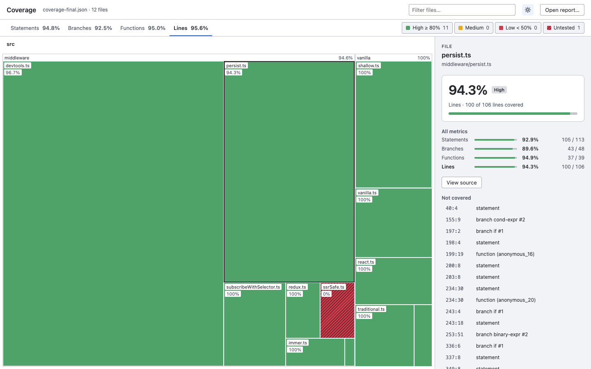
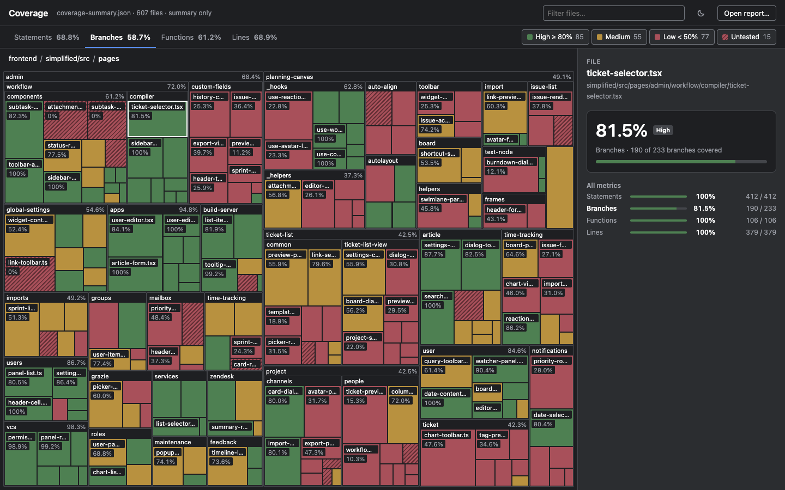
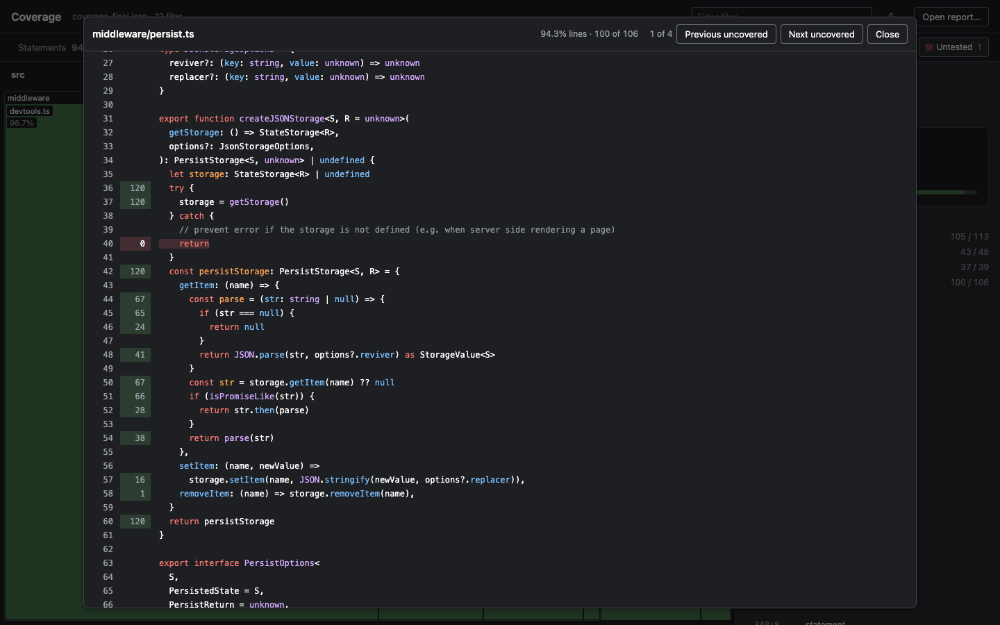

# treemap-code-coverage

Treemap viewer for [Istanbul](https://istanbul.js.org/) coverage reports. Tiles are files sized by lines and colored by the selected metric; folders zoom in on click. Double-click a file to read its source with hit counts and uncovered lines marked.

Reads `coverage-final.json` (full detail) or `coverage-summary.json` (totals only). A **Treemap | List** switch in the header toggles between the map and a sortable table of all files.







The screenshots show the coverage of [zustand](https://github.com/pmndrs/zustand) (MIT), measured with Vitest and the Istanbul provider. The report and its export are in [`examples/zustand`](examples/zustand).

## Install

```sh
npm install --save-dev treemap-code-coverage
```

## Use

```sh
npx treemap-code-coverage coverage/coverage-final.json
```

| Option | Description |
| --- | --- |
| `--root <dir>` | Folder that holds the sources. Sources are read only from under it and the current directory; report paths elsewhere are looked up under it by their path in the tree. Default: the current directory. |
| `--export <file>` | Write one self-contained HTML file with the report and sources instead of starting a server. |
| `--no-sources` | Skip the source preview. |
| `--port <number>` | Port to listen on. Default `4173`. |
| `--open` | Open the browser. |

The report stays on your machine; the server listens on `127.0.0.1` only.

### Export

```sh
npx treemap-code-coverage coverage/coverage-final.json --export coverage.html
```

The file holds the viewer, the report and the highlighted sources, and makes no network requests, so it can be attached to a CI run, sent in a message or opened from disk. Add `--no-sources` to leave the sources out. Open [`examples/zustand/index.html`](examples/zustand/index.html) after downloading it to see an export.

### Views

- **Treemap** (default): tiles sized by lines, folders zoom in, the side panel shows the selected file or folder.
- **List**: the files as a folder tree. Folder rows are highlighted and carry the totals of everything below them; each row has a bar, percentage and covered/total for Statements, Branches, Functions and Lines. Bars use the same thresholds as the treemap legend (High ≥ 80%, Medium, Low < 50%). It works with `coverage-summary.json` and needs no sources.

In the list, use the arrows to expand or collapse a folder, or **Expand all** / **Collapse all**. Click a header to sort by it (within each folder) and click again to reverse; the default is Lines ascending, so the least covered files come first. The header filter box matches the file path, keeps the folders above the matches open and the count reads "N of M files". Clicking a file or folder shows the same side panel as in the treemap, with **View source** when sources are available and **Show in treemap** to jump to it on the map.

The view and the selection are kept in the URL hash (`#v=list&s=<path>`), so a link to the list can be shared and the back button returns to it. **Show in treemap** uses `#z=<folder>&s=<file>`.

### Source preview

Sources are highlighted when the command starts, with [MicroLighter](https://github.com/davatron5000/microlighter) running under jsdom. The page itself loads no grammars. Only files up to 400 KB are included. Languages: JavaScript, TypeScript, CSS, HTML, JSON and a few others; other files show as plain text.

Open it by double-clicking a file, by pressing Enter on a selected file, or with **View source** in the side panel.

### Keyboard

- Tab enters the map; arrow keys move between tiles by position.
- Enter opens a folder or selects a file; Enter on a selected file opens its source. Backspace goes up one folder.
- In the list, Tab enters the table once and column headers are buttons. Up/Down (Home/End) move between rows, Right expands a folder or steps into it, Left collapses it or goes to the parent. Space selects the row and shows it in the side panel; Enter opens the source preview of a file (or toggles a folder).

### Theme

The icon in the header cycles System, Light and Dark. The choice is stored in the browser.

## License

[EUPL-1.2](LICENSE)
