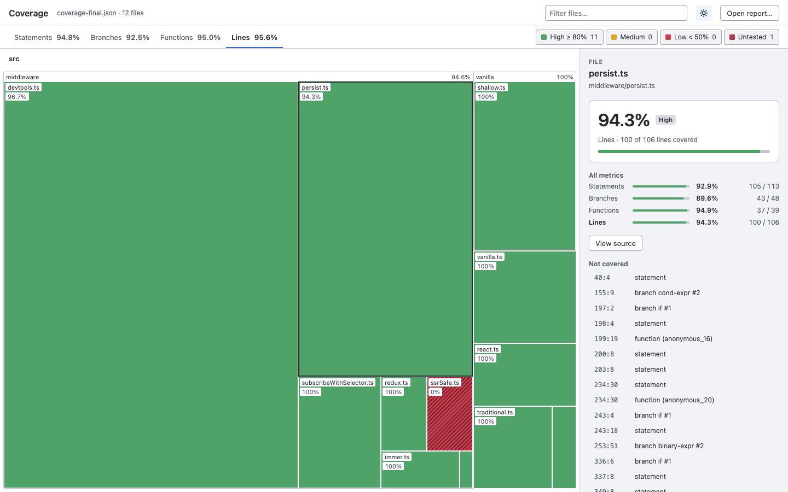
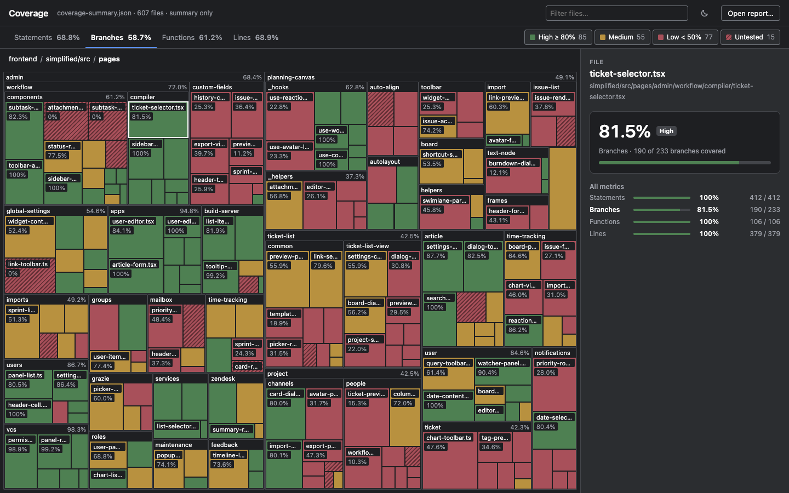
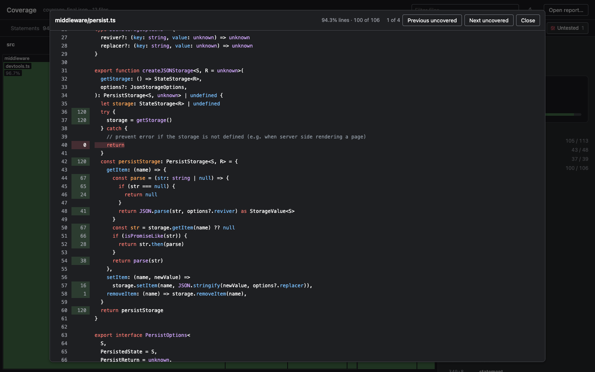

# treemap-code-coverage

Treemap viewer for [Istanbul](https://istanbul.js.org/) coverage reports. Tiles are files sized by lines and colored by the selected metric; folders zoom in on click. Double-click a file to read its source with hit counts and uncovered lines marked.

Reads `coverage-final.json` (full detail) or `coverage-summary.json` (totals only).







The first two screenshots show a mock report built from the design reference (`mock/coverage-summary.json`). The third shows this package's own source with synthetic hit counts.

## Install

```sh
npm install --save-dev treemap-code-coverage
```

## Use

```sh
npx treemap-code-coverage coverage/coverage-final.json
```

| Option | Description |
| --- | --- |
| `--root <dir>` | Folder that holds the sources. Sources are read only from under it and the current directory; report paths elsewhere are looked up under it by their path in the tree. Default: the current directory. |
| `--no-sources` | Skip the source preview. |
| `--port <number>` | Port to listen on. Default `4173`. |
| `--open` | Open the browser. |

The report stays on your machine; the server listens on `127.0.0.1` only.

### Source preview

Sources are highlighted when the command starts, with [MicroLighter](https://github.com/davatron5000/microlighter) running under jsdom. The page itself loads no grammars. Only files up to 400 KB are included. Languages: JavaScript, TypeScript, CSS, HTML, JSON and a few others; other files show as plain text.

Open it by double-clicking a file, by pressing Enter on a selected file, or with **View source** in the side panel.

### Keyboard

- Tab enters the map; arrow keys move between tiles by position.
- Enter opens a folder or selects a file; Enter on a selected file opens its source. Backspace goes up one folder.

### Theme

The icon in the header cycles System, Light and Dark. The choice is stored in the browser.

## Develop

```sh
npm install
npm run dev
```

Vite serves the page with hot reload. Put a report at `public/coverage-final.json` (or use **Open report…**). For the source preview, run:

```sh
npm run build:sources -- public/coverage-final.json --root <dir shown as the tree root>
```

`node tools/make-mock.mjs <Main.dc.html> mock/coverage-summary.json` rebuilds the mock report from the seeded data in `reference/Coverage map-html.zip` (extract `Main.dc.html` first).

`public/sources/`, `public/sample/` and report files in `public/` are ignored by git. `node tools/make-sample.mjs <dir> public/sample/coverage-final.json <subdir...>` writes a demo report with real paths and synthetic hit counts.

## Publish

Publishing to npm runs in GitHub Actions; no npm token is stored on a local machine.

1. Set `version` in `package.json` and merge it to `main`.
2. Create a GitHub release with the tag `v<version>`, for example `v0.1.1`.

The `Publish` workflow checks that the tag matches `version`, builds the viewer and runs `npm publish --provenance`, which links the package to the commit and workflow run that built it.

Authentication: npm only accepts a trusted publisher for a package that already exists, so the first release uses a token.

1. Create a granular npm token (read and write, with two-factor bypass) and save it as the repository secret `NPM_TOKEN`.
2. After the first release, open the package on npmjs.com → Settings → Trusted Publisher and add GitHub Actions with repository `srsatt/treemap-code-coverage` and workflow `publish.yml`.
3. Delete the `NPM_TOKEN` secret and revoke the token. Later releases authenticate through GitHub's OIDC identity.

`CI` builds and dry-runs the pack on every push to `main` and on pull requests.

## License

[EUPL-1.2](LICENSE)
